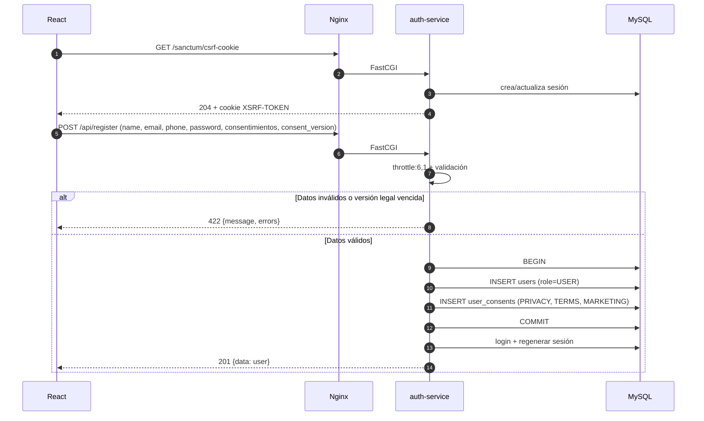
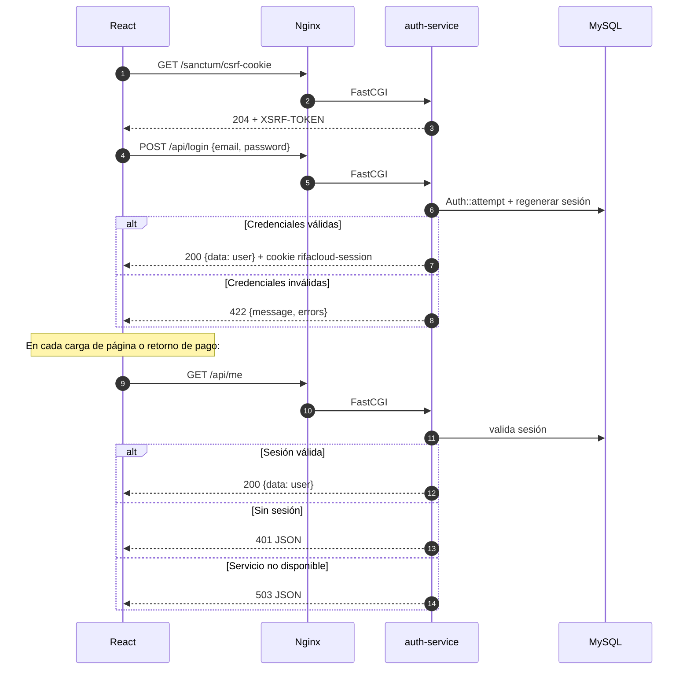
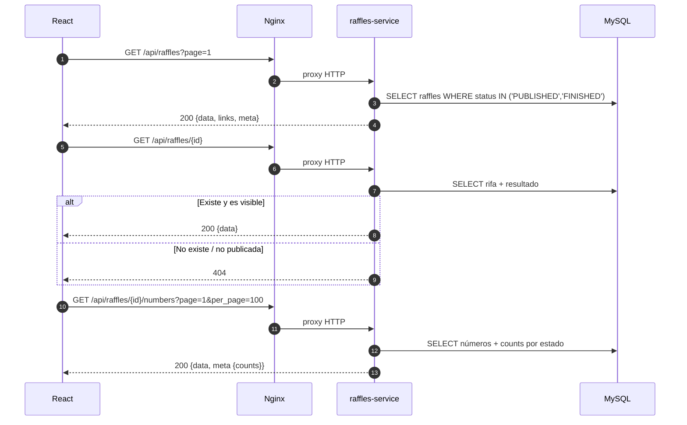
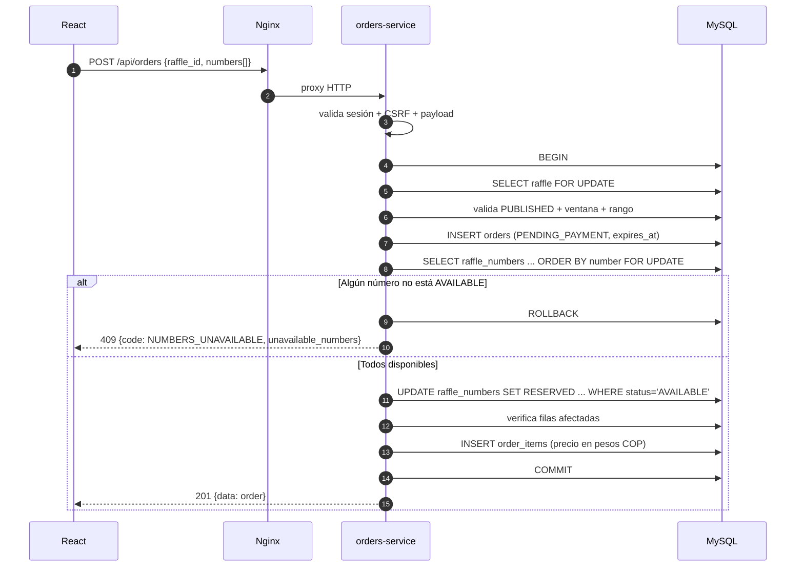
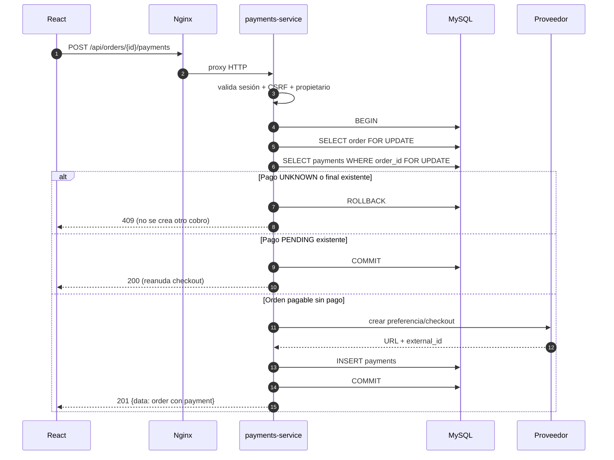
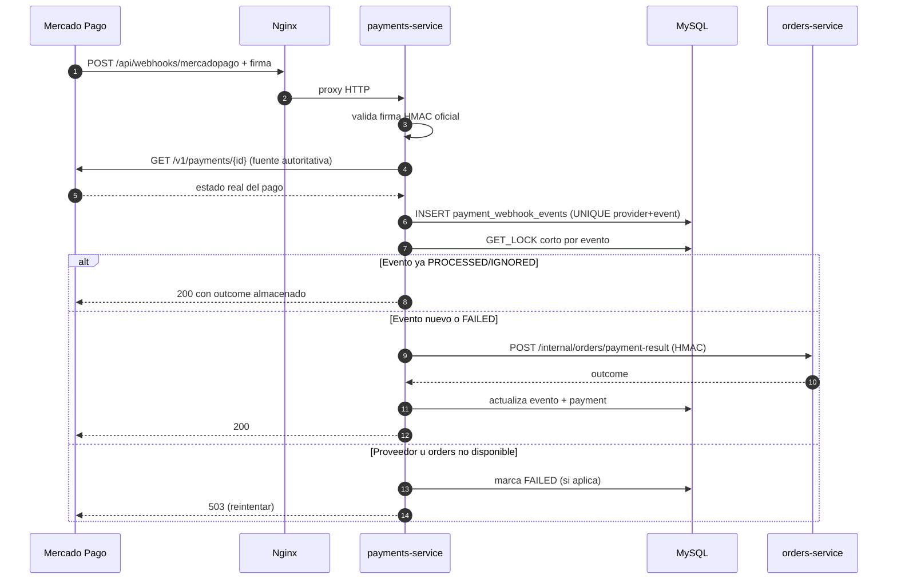
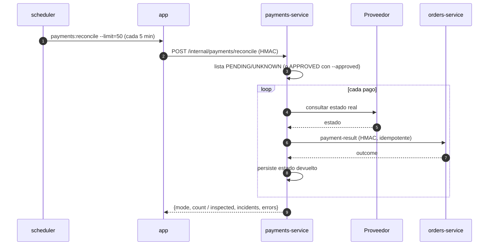
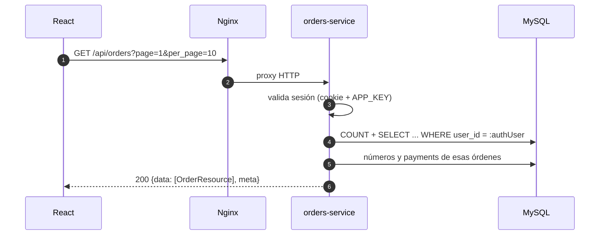
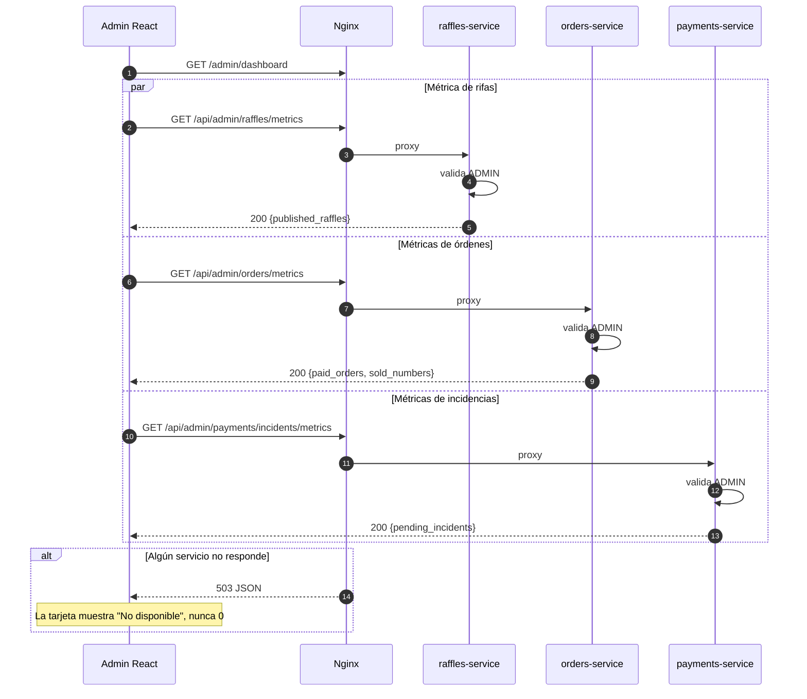

# RifaCloud — Flujos técnicos

**Proyecto:** RifaCloud  
**Uso:** explicar y defender el recorrido real de una compra y de la administración  
**Base:** rutas, controladores y servicios del repositorio al 2026-11-11

> **Convenciones de los diagramas**
>
> `FE` = React en el navegador · `N` = Nginx · `AS` = auth-service ·
> `RS` = raffles-service · `OS` = orders-service · `PS` = payments-service ·
> `DB` = MySQL · `MP` = Mercado Pago · `SCH` = scheduler.
>
> Los diagramas muestran el camino **implementado**. Cuando un paso es una
> validación o una transacción, se indica explícitamente.

---

## 0. Mapa rápido de flujos

| Flujo | Servicio dueño | Endpoints principales | Invariante central |
|---|---|---|---|
| Registro | `auth-service` | `GET /sanctum/csrf-cookie`, `POST /api/register` | Dos consentimientos obligatorios y versión vigente |
| Login/sesión | `auth-service` | `POST /api/login`, `GET /api/me`, `POST /api/logout` | Cookie HttpOnly; 401 solo si la sesión no existe |
| Catálogo | `raffles-service` | `GET /api/raffles`, `GET /api/raffles/{id}`, `.../numbers` | Solo `PUBLISHED` y `FINISHED` visibles |
| Reserva | `orders-service` | `POST /api/orders` | Un número no puede pertenecer a dos reservas activas |
| Checkout/verificación | `payments-service` + `orders-service` | `POST /api/orders/{id}/payments`, `.../verify` | El servidor decide; la URL no aprueba |
| Webhook | `payments-service` | `POST /api/webhooks/mercadopago` | Firma + evento único + comando idempotente |
| Expiración/reconciliación | scheduler + `orders-service` + `payments-service` | comandos internos firmados | Nunca liberar con pago incierto |
| Historial | `orders-service` | `GET /api/orders` | Filtro por propietario en SQL |
| Resultado | `raffles-service` | `POST /api/admin/raffles/{id}/result` | Solo número `SOLD`, una vez, con evidencia |
| Dashboard | 3 servicios | `GET /api/admin/*/metrics` | Cada servicio calcula lo suyo; 503 ≠ 0 |

---

## 1. Registro e inicio de sesión

### 1.1 Registro

**Objetivo:** crear un usuario `USER`, registrar la evidencia de consentimiento y
dejar una sesión válida.

**Precondiciones:** el navegador obtuvo la cookie CSRF; el email no existe; la
versión legal enviada es la vigente (`2026-11-11`).



**Reglas reales:**

- `privacy_consent` y `terms_consent` son obligatorios y deben ser `true`.
- `marketing_consent` es opcional y se guarda en una fila separada.
- `consent_version` debe coincidir con `LEGAL_CONSENT_VERSION`.
- La contraseña se hashea; el rol inicial es `USER`.
- El registro está limitado a 6 intentos por minuto (`throttle:6,1`) en
  `auth-service` y en la ruta de rollback del monolito.
- La evidencia se escribe con `insertOrIgnore`; el `UNIQUE(user_id, type,
  document_version)` evita duplicados.
- La tabla `user_consents` y su grant fueron aplicados a `rifacloud` el
  2026-11-12 (ver `AGENTS.md`; el SDD puede reflejar el estado previo). El
  código conserva un *fallback*: si la tabla no existiera, el registro
  continuaría, pero la evidencia no se persistiría y se registraría un warning.

**Errores esperados:** `422` por validación, `429` por throttle, `503` si
`auth-service` o MySQL no están disponibles.

**Archivos:** `services/auth-service/routes/api.php`,
`app/Http/Requests/RegisterRequest.php`,
`app/Http/Controllers/AuthController.php`,
`app/Services/ConsentRecorder.php`,
`src/database/migrations/2026_11_11_000011_create_user_consents_table.php`.

### 1.2 Inicio de sesión y recuperación de sesión



**Decisión de continuidad (S6):**

- Solo un `401` explícito significa “anónimo”.
- Un `503`, timeout o error de red se muestra como “sesión no disponible” con
  reintento; **no** borra la sesión.
- Las credenciales viven en la cookie HttpOnly; no se guardan en
  `localStorage`.
- Un `419` de CSRF se reintenta una vez tras refrescar
  `/sanctum/csrf-cookie`; `409` y `503` no se reintentan a ciegas.
- `RequireAuth`/`AdminRoute` guardan la ruta original para volver después del
  login.

**Archivos:** `services/auth-service/app/Http/Controllers/AuthController.php`,
`frontend/src/auth/AuthContext.tsx`, `frontend/src/api/client.ts`,
`frontend/src/components/RequireAuth.tsx`,
`frontend/src/components/AdminRoute.tsx`.

---

## 2. Consulta de rifas

**Objetivo:** mostrar catálogo, detalle y disponibilidad de números sin exigir
autenticación.



**Reglas reales:**

- El catálogo incluye `PUBLISHED` y `FINISHED`; las rifas `DRAFT` y `CLOSED`
  no aparecen.
- Paginación del catálogo: 15 por página.
- Números: `per_page` por defecto 100, máximo 200.
- El detalle de una rifa finalizada incluye `result` con número ganador, fecha y
  evidencia.
- El frontend deriva “próximamente / disponible / cerrada / finalizada” a partir
  del estado del backend y de `starts_at`/`ends_at`; **el servidor conserva
  todas las validaciones** de ventana y estado al reservar.
- Si `raffles-service` está caído, Nginx devuelve 503 JSON; auth, órdenes y
  pagos no se detienen.

**Archivos:** `services/raffles-service/src/Application.php`,
`src/RaffleRepository.php`, `src/RafflePresenter.php`,
`frontend/src/lib/raffle.ts`, `frontend/src/pages/CatalogPage.tsx`,
`frontend/src/pages/RaffleDetailPage.tsx`.

---

## 3. Reserva de números y prevención de doble venta

**Objetivo:** crear una orden `PENDING_PAYMENT` y reservar varios números en una
sola transacción, sin doble venta.



### 3.1 La transacción, paso a paso

1. `SELECT ... FROM raffles WHERE id = ? FOR UPDATE`: serializa cambios
   administrativos de la rifa con la reserva.
2. `INSERT INTO orders (...) VALUES ('PENDING_PAYMENT', now + RESERVATION_MINUTES)`.
3. `SELECT ... FROM raffle_numbers ... ORDER BY number FOR UPDATE`: bloquea las
   filas solicitadas en orden ascendente para evitar deadlocks.
4. `UPDATE raffle_numbers SET status='RESERVED', reserved_at, reserved_until,
   order_id WHERE id IN (...) AND status='AVAILABLE'`.
5. Comprueba que las filas afectadas sean exactamente las solicitadas.
6. Inserta `order_items` con `price_at_purchase`.
7. `COMMIT`.

### 3.2 Por qué no hay doble venta

- `SELECT ... FOR UPDATE` obliga a la segunda transacción a esperar.
- La segunda transacción ve el número en `RESERVED` y devuelve `409`.
- `UNIQUE(raffle_id, number)` es la última defensa a nivel de base.
- La comprobación de filas afectadas evita un `UPDATE` parcial.
- Los reintentos solo cubren deadlock (`1213`), lock wait timeout (`1205`),
  SQLSTATE `40001` o duplicado de `order_number`; máximo 3 intentos.

### 3.3 Resultado de concurrencia

La prueba real con dos procesos PHP lanza dos `POST /api/orders` simultáneos por
los mismos números. El resultado esperado y registrado es:

- exactamente **un `201`**;
- exactamente **un `409`** con `NUMBERS_UNAVAILABLE`;
- **una sola orden** creada;
- los números reservados una sola vez.

### 3.4 Límites y errores

- `ORDER_MAX_NUMBERS=50` es una protección técnica del payload, no una regla de
  negocio.
- `401` sin sesión; `419` CSRF; `422` validación; `409` rifa no disponible,
  fuera de ventana o números ocupados; `503` si el servicio/DB no está.
- La orden de otro usuario devuelve `404`, no `403`, para no revelar su
  existencia.

**Archivos:** `services/orders-service/src/Orders/OrderReservationService.php`,
`OrderApplication.php`, `OrderRepository.php`,
`services/orders-service/tests/concurrent_create.php`,
`src/app/Modules/Orders/Services/OrderReservationService.php` (rollback).

---

## 4. Checkout, verificación y confirmación de pago

### 4.1 Crear o reanudar el checkout



**Reglas reales:**

- `UNIQUE(order_id)` impide un segundo pago lógico para la misma orden.
- Un pago `PENDING` se reanuda (`200`), no se duplica.
- Un pago `UNKNOWN` o final bloquea un checkout nuevo (`409`).
- La orden debe estar `PENDING_PAYMENT` y no vencida.
- El proveedor se llama dentro de la transacción; si falla, no se crea fila de
  pago.
- En modo simulado, el `checkout_url` es interno
  (`/checkout/simulated/SIM-COP-...`) y `simulated=true`; el frontend no
  redirige, muestra “Verificar pago”.
- En Mercado Pago, `external_reference = MP-ORDER-{id}` se reutiliza como
  `X-Idempotency-Key`; en sandbox se usa `sandbox_init_point`.

### 4.2 Verificar el pago (camino del comprador)

```mermaid
sequenceDiagram
    autonumber
    participant FE as React
    participant N as Nginx
    participant PS as payments-service
    participant MP as MercadoPago Fake
    participant OS as orders-service
    participant DB as MySQL

    FE->>N: POST /api/orders/{id}/payments/{payment}/verify
    N->>PS: proxy HTTP
    PS->>DB: lee orden y pago; valida propietario
    alt Orden en PAYMENT_REVIEW
        PS-->>FE: 409 (requiere ADMIN)
    else Orden verificable
        PS->>MP: consultar pago por external_reference
        alt Proveedor no tiene pago aún
            MP-->>PS: no encontrado
            PS-->>FE: 200 sin cambiar estado
        else Timeout
            MP-->>PS: timeout
            PS->>PS: estado = UNKNOWN
        else Estado recibido
            MP-->>PS: APPROVED / REJECTED / PENDING / ...
        end
        PS->>PS: valida external_id, monto y moneda
        PS->>OS: POST /internal/orders/payment-result (HMAC)
        OS->>DB: BEGIN; lock orders → payments → raffle_numbers
        OS->>OS: aplica máquina de estados + guardas de stale
        OS->>DB: vende/libera números; actualiza orden
        OS->>DB: COMMIT
        OS-->>PS: {outcome, payment_status, order_status}
        PS->>DB: persiste payment_status en su fila
        PS-->>FE: 200 {data: order}
    end
```

**Puntos que el profesor puede preguntar:**

- La URL `?pago=retorno` es **solo una pista**; el frontend dispara una
  verificación server-side una vez y muestra el estado real.
- Un `409` al verificar hace que el frontend relea la orden (por ejemplo, pasó a
  revisión), no que invente un error.
- Un `503` mantiene la orden y la sesión en pantalla con opción de reintentar.
- La aprobación nunca se deduce del navegador.

### 4.3 Webhook del proveedor



**Idempotencia real:**

1. Firma oficial: manifiesto `id:{data.id};request-id:{x-request-id};ts:{ts};`.
2. Se vuelve a consultar el pago; el cuerpo del webhook no es prueba.
3. `UNIQUE(provider, provider_event_id)` evita una segunda fila de evento.
4. Lock corto por evento para entregas simultáneas.
5. El comando a `orders-service` converge por estado: mismos estados = no-op;
   los números se mueven una sola vez; `paid_at` se fija una sola vez.
6. Un evento obsoleto devuelve `ignored` sin segundo efecto.
7. Si el proveedor o `orders-service` fallan, se responde `503` para que
   Mercado Pago reintente; nunca un `200` silencioso.

### 4.4 Matriz de resultados

| Resultado del proveedor | Orden | Números | Observación |
|---|---|---|---|
| `APPROVED` y números disponibles | `PAID` | `SOLD` | Venta única; `paid_at` una vez |
| `REJECTED` | `REJECTED` | Vuelven a `AVAILABLE` | Si no estaban `SOLD` |
| `PENDING` | `PENDING_PAYMENT` | Siguen `RESERVED` | Aún no hay confirmación |
| `UNKNOWN` / timeout | `PAYMENT_REVIEW` | Siguen `RESERVED` | Requiere revisión humana; no se liberan |
| `APPROVED` tardío (reserva vencida/rechazada) | `REQUIRES_REFUND` | No se reasignan | `REFUND_REQUIRED`; reembolso manual |
| `APPROVED` con números ya no disponibles | `REQUIRES_REFUND` | No se duplican | Incidente |
| Webhook duplicado | Sin cambio | Sin cambio | `ignored`/`processed` |
| Reserva vencida sin pago | `EXPIRED` | Vuelven a `AVAILABLE` | Solo `PENDING_PAYMENT` |

**Archivos:** `services/payments-service/src/Payments/CheckoutService.php`,
`VerificationService.php`, `WebhookService.php`, `PaymentRepository.php`,
`services/orders-service/src/Orders/PaymentResultApplier.php`,
`frontend/src/pages/OrderDetailPage.tsx`.

---

## 5. Expiración de reservas y reconciliación

### 5.1 Expiración

```mermaid
sequenceDiagram
    autonumber
    participant SCH as scheduler
    participant APP as app
    participant OS as orders-service
    participant DB as MySQL

    SCH->>APP: orders:expire-reservations (cada minuto)
    APP->>OS: POST /internal/orders/expire-reservations (HMAC)
    OS->>DB: GET_LOCK('rifacloud_orders_expire_reservations', 0)
    alt Otro proceso tiene el lock
        OS-->>APP: {expired:0, skipped:true}
    else Lock obtenido
        OS->>DB: SELECT órdenes PENDING_PAYMENT vencidas (chunks de 100)
        loop cada orden
            OS->>DB: BEGIN; lock order
            OS->>DB: lock payments; si UNKNOWN/APPROVED/REFUND_REQUIRED → no liberar
            OS->>DB: lock raffle_numbers; si hay SOLD → no liberar
            OS->>DB: UPDATE números RESERVED → AVAILABLE
            OS->>DB: UPDATE order → EXPIRED
            OS->>DB: COMMIT
        end
        OS-->>APP: {expired:N, skipped:false}
    end
```

**Reglas reales:**

- Solo expira órdenes `PENDING_PAYMENT` con `expires_at <= now`.
- Nunca libera si hay un pago `UNKNOWN`, `APPROVED` o `REFUND_REQUIRED`.
- Nunca libera si algún número está `SOLD`.
- Los `order_items` se conservan para auditoría.
- Si `orders-service` no responde, el comando del monolito termina con error y
  no libera nada localmente; la siguiente ejecución reintenta.

### 5.2 Reconciliación



**Reglas reales:**

- La reconciliación **no crea checkout ni cobro**; solo vuelve a consultar.
- `--dry-run` cuenta sin llamar al proveedor.
- `--approved` reaudita pagos ya aprobados por cobros adicionales.
- Si `payments-service` no responde, el comando falla en cerrado.
- Es idempotente porque reutiliza el mismo comando de resultado.

**Archivos:** `src/routes/console.php`,
`src/app/Console/Commands/ExpireReservations.php`,
`src/app/Console/Commands/ReconcilePayments.php`,
`services/orders-service/src/Orders/ReservationExpiryService.php`,
`services/payments-service/src/Payments/VerificationService.php`.

---

## 6. Historial de compras (“Mis compras”)



**Reglas reales:**

- Solo el propietario autenticado; el `user_id` sale de la sesión, nunca del
  cliente.
- Ordenadas de más reciente a más antigua.
- `per_page` por defecto 10, máximo 50.
- Cada entrada incluye rifa, números con su estado real, total, fechas y pagos.
- Solo un número `SOLD` se presenta como comprado; `RESERVED` se muestra como
  reservado y `AVAILABLE` como liberado.
- La orden de otro usuario devuelve `404`; un usuario sin órdenes recibe una
  lista vacía, no un error.
- La página `/orders` usa `RequireAuth`; un `401` redirige al login, un `503`
  muestra indisponibilidad.

**Archivos:** `services/orders-service/src/Orders/OrderApplication.php`
(`list`, `show`), `OrderRepository.php`, `OrderPresenter.php`,
`frontend/src/pages/OrdersPage.tsx`,
`frontend/src/pages/OrderDetailPage.tsx`.

---

## 7. Publicación de ganadores

**Objetivo:** que un administrador publique manualmente el resultado de una rifa
cerrada, con evidencia y sin reasignar números.

```mermaid
sequenceDiagram
    autonumber
    participant AD as Admin React
    participant N as Nginx
    participant RS as raffles-service
    participant DB as MySQL

    AD->>N: POST /api/admin/raffles/{id}/close
    N->>RS: proxy HTTP
    RS->>RS: valida sesión ADMIN + CSRF
    RS->>DB: PUBLISHED → CLOSED
    RS-->>AD: 200 {data}

    AD->>N: POST /api/admin/raffles/{id}/result
    N->>RS: proxy HTTP
    RS->>RS: valida ADMIN + CSRF
    RS->>DB: BEGIN; lock raffle
    RS->>RS: exige CLOSED, una sola vez, número en rango
    RS->>DB: busca raffle_number SOLD con ese número
    alt Número no vendido / fuera de rango / ya hay resultado
        RS->>DB: ROLLBACK
        RS-->>AD: 422
    else Válido
        RS->>DB: INSERT raffle_results (ganador, evidencia, fecha, admin)
        RS->>DB: UPDATE raffle → FINISHED
        RS->>DB: COMMIT
        RS-->>AD: 200 {data}
    end

    AD->>N: GET /api/raffles/{id}
    N->>RS: proxy HTTP
    RS->>DB: rifa FINISHED + resultado
    RS-->>AD: 200 {data con result}
```

**Reglas reales:**

- El resultado no se sortea automáticamente: lo publica un ADMIN.
- La rifa debe estar `CLOSED`; la transición válida es
  `DRAFT → PUBLISHED → CLOSED → FINISHED`.
- El número debe estar dentro del rango y tener estado `SOLD`; lo determina
  `orders-service` al vender.
- `evidence_description` es obligatorio (máximo 2000 caracteres);
  `evidence_url` es opcional (máximo 500 y URL válida).
- `raffle_results.raffle_id` es único: no se publica dos veces.
- El catálogo público conserva rifas `FINISHED` y muestra el resultado.
- Si la tabla `raffle_results` no existe, la operación falla con validación
  controlada; no se inventa un resultado.

**Archivos:** `services/raffles-service/src/Admin/AdminApplication.php`,
`RaffleAdminService.php`, `RaffleAdminRepository.php`,
`src/database/migrations/2026_11_07_000009_create_raffle_results_table.php`,
`frontend/src/pages/admin/AdminRafflesPage.tsx`,
`frontend/src/pages/RaffleDetailPage.tsx`.

---

## 8. Dashboard administrativo

**Objetivo:** mostrar cuatro indicadores sin cargar todas las órdenes ni números
en React.



**Definiciones exactas:**

| Indicador | Consulta | Servicio |
|---|---|---|
| Rifas publicadas | `COUNT(*) FROM raffles WHERE status='PUBLISHED'` | `raffles-service` |
| Órdenes pagadas | `COUNT(*) FROM orders WHERE status='PAID'` | `orders-service` |
| Números vendidos | `COUNT(*) FROM raffle_numbers WHERE status='SOLD'` | `orders-service` |
| Incidencias pendientes | `COUNT(*) FROM payments WHERE status IN ('UNKNOWN','REFUND_REQUIRED')` | `payments-service` |

**Reglas reales:**

- Los tres endpoints exigen ADMIN en el servicio propietario, no solo en React.
- Nginx mapea un fallo de cada servicio a un 503 controlado.
- El frontend lanza las tres consultas con `Promise.all`; cada `fetchMetric`
  captura su propio error y muestra “No disponible” por tarjeta, sin inventar un
  cero.
- No se cargan órdenes ni números completos para calcular los indicadores.

**Archivos:** `frontend/src/pages/admin/AdminDashboardPage.tsx`,
`services/raffles-service/src/Admin/AdminApplication.php`,
`services/orders-service/src/Orders/OrderApplication.php`,
`services/payments-service/src/Payments/PaymentApplication.php`,
`docker/nginx/default.conf`.

---

## 9. Secuencia completa de una compra (resumen para pizarra)

```text
1. Registro/login        → auth-service → users/sessions
2. Catálogo              → raffles-service → raffles/raffle_numbers
3. Reserva               → orders-service → orders/order_items + números RESERVED
4. Checkout              → payments-service → payments (PENDING)
5. Verificación/webhook  → payments-service → proveedor → orders-service
6. Resultado             → orders-service → PAID/SOLD o REVIEW/REFUND
7. Historial             → orders-service → solo órdenes del dueño
8. Expiración            → scheduler → orders-service → libera solo PENDING_PAYMENT
9. Resultado de rifa     → admin → raffles-service → raffle_results + FINISHED
10. Dashboard            → 3 servicios → métricas agregadas
```

---

## 10. Archivos que respaldan estos flujos

| Flujo | Archivos |
|---|---|
| Registro/login | `services/auth-service/routes/api.php`, `app/Http/Controllers/AuthController.php`, `app/Http/Requests/RegisterRequest.php`, `frontend/src/auth/AuthContext.tsx` |
| Catálogo | `services/raffles-service/src/Application.php`, `RaffleRepository.php`, `RafflePresenter.php` |
| Reserva | `services/orders-service/src/Orders/OrderReservationService.php`, `OrderApplication.php` |
| Checkout/verify | `services/payments-service/src/Payments/CheckoutService.php`, `VerificationService.php`, `PaymentApplication.php` |
| Webhook | `services/payments-service/src/Payments/WebhookService.php`, `MercadoPagoGateway.php` |
| Expiración | `services/orders-service/src/Orders/ReservationExpiryService.php`, `src/routes/console.php` |
| Reconciliación | `services/payments-service/src/Payments/VerificationService.php`, `src/app/Console/Commands/ReconcilePayments.php` |
| Historial | `services/orders-service/src/Orders/OrderApplication.php`, `OrderRepository.php`, `OrderPresenter.php` |
| Resultado | `services/raffles-service/src/Admin/RaffleAdminService.php`, `RaffleAdminRepository.php` |
| Dashboard | `frontend/src/pages/admin/AdminDashboardPage.tsx`, endpoints de métricas |
| Rutas públicas | `docker/nginx/default.conf` |
| Contratos y estados | `docs/sdd/02-technical-design.md`, `docs/sdd/03-data-model.md`, `docs/sdd/05-acceptance-criteria.md` |

---

## 11. Tres frases para explicar cualquier flujo

1. **“El navegador solo habla con Nginx; Nginx enruta al servicio dueño.”**
2. **“La decisión de negocio ocurre en el servicio dueño, dentro de una
   transacción o con un comando idempotente.”**
3. **“Si el servicio no está, el sistema falla en cerrado con un 503; no inventa
   una orden, un pago ni un número vendido.”**
